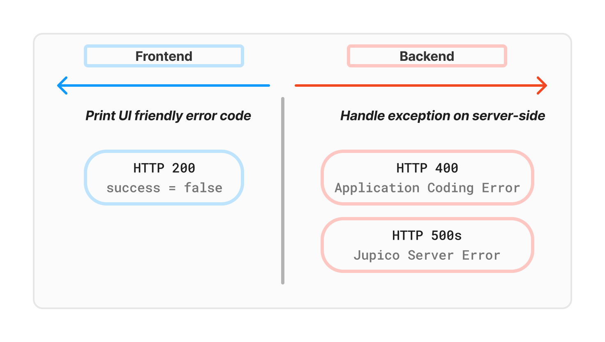
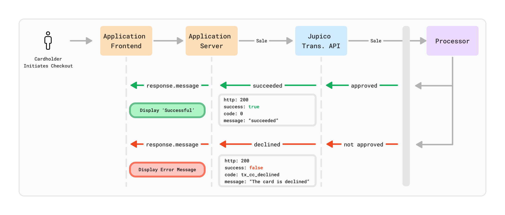
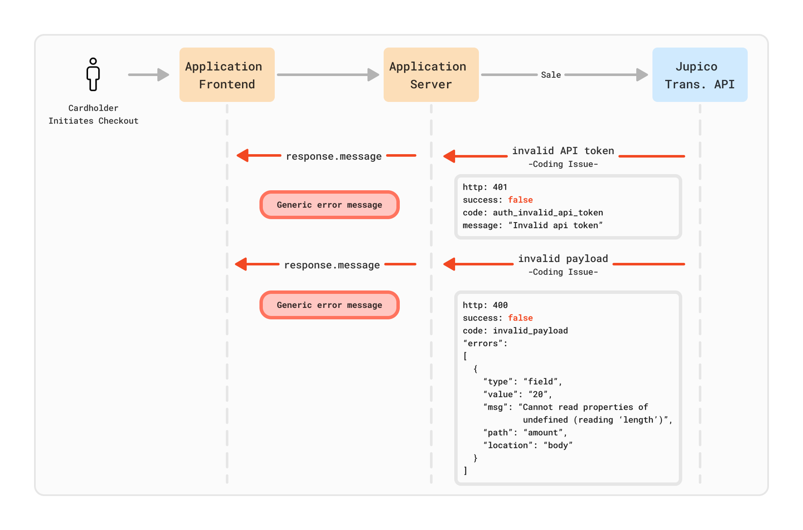
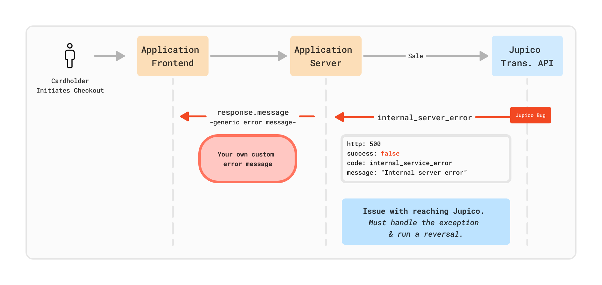
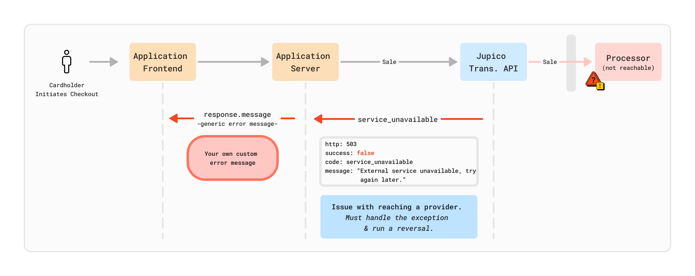

<Columns cols={2}>
  <Column>
    Split error handling between customer-facing application logic and server-side operational logic. Some errors are safe to surface directly to the customer; others must be handled on your server and mapped to a safe message.
  </Column>
  <Column>
    <Frame>
      
    </Frame>
  </Column>
</Columns>

## Handling HTTP 200 application errors

<Frame>
  
</Frame>

Some requests return HTTP `200` with `success: false`. These are application-level outcomes, such as a card decline.

```json
{
  "success": false,
  "code": "tx_cc_declined_incorrect_cvc",
  "message": "The card security code is incorrect."
}
```

<Steps>
  <Step title="Treat as unsuccessful">
    Do not fulfill the order or advance the workflow.
  </Step>
  <Step title="Show a clear message">
    Display the message to the customer or map it to safer copy.
  </Step>
  <Step title="Let the customer correct or retry">
    Offer another payment method when appropriate.
  </Step>
  <Step title="Store the code">
    Persist `code` for troubleshooting and reporting.
  </Step>
</Steps>

<Info>
  HTTP `200` with `success: false` is often appropriate for direct UI messaging, especially for payment declines and other user-correctable conditions.
</Info>

## Handling HTTP 400 errors

<Frame>
  
</Frame>

HTTP `400` responses usually indicate invalid payloads, invalid operations, or workflow errors.

<Steps>
  <Step title="Handle on the server">
    Do not surface the raw response to the browser.
  </Step>
  <Step title="Log the context">
    Preserve the request, response body, and `X-Request-ID`.
  </Step>
  <Step title="Map to safe copy">
    Translate the raw error into a customer-safe message.
  </Step>
  <Step title="Fix the request">
    Correct the payload, route, referenced IDs, or operation sequence.
  </Step>
</Steps>

<Warning>
  Do not expose raw server-side error details in the browser UI. Some error information may be sensitive or implementation-specific.
</Warning>

## Handling HTTP 401 and 403 errors

Authentication and permission errors usually mean the request is missing credentials, using invalid credentials, or attempting an operation the API user, submerchant, or product is not allowed to perform.

Common causes:

- Missing `Authorization` header
- Invalid API token
- Inactive API user
- Inactive submerchant
- Disabled feature
- Invalid `Content-Type`

See [Authentication](/api-reference/authentication) for troubleshooting details.

## Handling HTTP 500 errors

HTTP `500` indicates an internal server-side failure. For transaction operations, initiate rollback handling where applicable.



<Steps>
  <Step title="Do not assume safe failure">
    A `500` does not guarantee that no money moved.
  </Step>
  <Step title="Run rollback where supported">
    See [Timeout Handling](/api-reference/timeout-handling) for the reversal flow.
  </Step>
  <Step title="Preserve context">
    Log the `X-Request-ID`, request payload, response, and operation type.
  </Step>
  <Step title="Escalate if unresolved">
    Contact Jupico support if the state remains unclear.
  </Step>
</Steps>

## Handling HTTP 503 errors

<Frame>
  
</Frame>

HTTP `503` indicates that one or more external services are temporarily unavailable.

<Steps>
  <Step title="Retry later with backoff">
    Do not retry aggressively.
  </Step>
  <Step title="Do not reverse on 503 alone">
    A reversal is not required solely because the response was `503`.
  </Step>
  <Step title="Continue monitoring">
    Wait for the operation to succeed, decline, or return a different error.
  </Step>
</Steps>

## Idempotency

The Jupico API doesn't support idempotency keys. That applies to transaction operations (sale, authorization, capture, void, refund) and to provisioning calls.

- An `Idempotency-Key` header is ignored.
- Unknown fields in the request body are rejected, so you can't send a key in the body either.

Use these tools instead to avoid duplicate charges.

### Tag every transaction with `referenceId`

Send your own ID in `referenceId` on every transaction. It accepts up to 36 characters and is stored with the transaction. After a timeout, search for it with [List transactions](/api-reference/query/list-transactions) to see whether the transaction went through:

```json
{ "referenceId": "order-8812-attempt-1" }
```

<Warning>
  Jupico doesn't enforce `referenceId` uniqueness. Sending the same value twice creates two transactions. Use it to look up a transaction, not to block a duplicate.
</Warning>

### Turn on duplicate blocking

Jupico can block duplicate sales and authorizations for a submerchant. When it's on, a request that matches a recent transaction is declined with `tx_cc_duplicate`. Ask your Jupico account team to enable it per submerchant. In sandbox, send amount `100.12` with the [decline test token](/api-reference/environments-testing-data#simulating-declines-and-errors) to trigger it.

{/* TODO: Document what counts as a duplicate (matching fields) and the time window. */}

### Built-in safeguards

| Operation | What happens on a repeat |
| --- | --- |
| Void | A transaction can be voided only once. A second void doesn't apply again. |
| Refund | Refunds are capped at the remaining balance. Repeated refunds can't return more than was captured. |
| Sale, authorization, capture | No built-in protection. Use `referenceId` and duplicate blocking. |

## Server-side handling checklist

- Validate required fields before sending requests.
- Preserve request and response logs.
- Save the `X-Request-ID` on every call.
- Use safe customer-facing error messages.
- Never expose API credentials in the browser.
- Implement [timeout handling](/api-reference/timeout-handling) and rollback logic for transaction operations.
- Add alerts for repeated `500`, `503`, and authentication failures.

## Related pages

<CardGroup cols={2}>
  <Card title="Error Codes" icon="list" href="/api-reference/error-codes">
    Full catalog of `code` values with recommended handling.
  </Card>

  <Card title="Status Codes" icon="signal" href="/api-reference/status-codes">
    HTTP status codes and their integration behavior.
  </Card>

  <Card title="Timeout Handling" icon="clock" href="/api-reference/timeout-handling">
    Reversal and retry flows when a request times out.
  </Card>

  <Card title="Transaction Status Handling" icon="list-check" href="/api-reference/transaction-status-handling">
    Handle `succeeded`, `declined`, and `failed` outcomes.
  </Card>
</CardGroup>